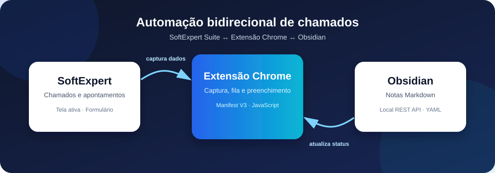
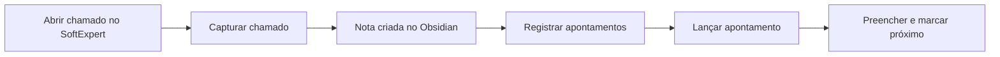

# Automação SoftExpert & Obsidian

<p align="center">
  <strong>Uma ponte rápida entre chamados, conhecimento e apontamentos.</strong><br>
  Extensão Chrome para o suporte N1 Sankhya.
</p>

<p align="center">
  
  
  
</p>



## Visão geral

Esta extensão integra o **SoftExpert Suite** ao **Obsidian** para evitar retrabalho no atendimento: ela transforma o chamado aberto em uma nota organizada e, na outra direção, usa os apontamentos pendentes das notas para preencher o formulário do SoftExpert.

| Do SoftExpert para o Obsidian | Do Obsidian para o SoftExpert |
| --- | --- |
| Captura dados e histórico do chamado ativo | Carrega a fila de apontamentos pendentes |
| Cria uma nota Markdown com metadados YAML | Preenche chamado, data, horários e atividade |
| Organiza o contexto do atendimento | Marca a nota como concluída após o lançamento |

## O que a extensão faz

### 📥 Capturar chamado

Com o chamado aberto no SoftExpert, a extensão identifica e registra:

- número, título, solicitante e descrição;
- histórico de trâmites, com data, responsável, papel e atividade;
- uma nota Markdown estruturada no Vault do Obsidian;
- a base para uma fila de apontamentos vinculada ao chamado.

### ⏱️ Lançar apontamentos

Na aba **Lançar Apontamentos**, a extensão lê as notas pelo Local REST API e mostra somente os itens com `status: pendente`.

- Preenche automaticamente o chamado, a data (`DD/MM/YYYY`), horários (`HH:MM`) e a atividade executada.
- Atualiza o YAML do Obsidian para `apontado` e conclui a checklist visual (`- [ ]` → `- [x]`).
- Quando todos os itens terminam, atualiza o status geral para `status_apontamento: apontado`.
- O modo **🚀 Preencher & Marcar Próximo** lança o item atual, confirma a atualização no Obsidian e avança a fila em uma única ação.

## Como instalar

### Pré-requisitos

- Google Chrome, Microsoft Edge ou Brave;
- Obsidian aberto;
- plugin **Local REST API** ativo e configurado no Obsidian;
- acesso ao SoftExpert.

### Carregar a extensão

1. Abra `chrome://extensions/` no navegador.
2. Ative o **Modo do desenvolvedor**.
3. Clique em **Carregar sem compactação**.
4. Selecione a pasta deste projeto.
5. Fixe a extensão na barra de ferramentas para acesso rápido.

> A configuração da chave da API e da pasta do Vault é feita no próprio popup da extensão. Trate essa chave como uma credencial: não a publique em documentação, commits ou capturas de tela.

## Uso diário



1. Abra o chamado ou o modal de apontamento no SoftExpert.
2. Clique no ícone da extensão.
3. Para documentar o atendimento, use **Capturar Chamado** e escolha **Criar Nota no Obsidian**.
4. Para lançar horas, acesse **Lançar Apontamentos**, revise o item selecionado e escolha uma ação:
   - **Preencher Formulário no SE** — preenche os campos, sem concluir a nota;
   - **Marcar como Apontado no Obsidian** — apenas atualiza a nota;
   - **Preencher & Marcar Próximo** — executa o fluxo completo e segue para o próximo item.

## Arquitetura

```text
SoftExpert Suite
      │  leitura da tela / preenchimento do formulário
      ▼
Extensão Chrome (Manifest V3)
      │  HTTPS local · Local REST API
      ▼
Obsidian Vault
      └─ Notas Markdown + frontmatter YAML + checklists
```

## Estrutura do projeto

```text
softexpert-obsidian-n1/
├── manifest.json             # Manifesto e permissões da extensão
├── popup.html                # Interface do popup
├── popup.js                  # Fila, interface e integração com o Obsidian
├── content.js                # Leitura da tela e ponte de mensageria
├── se-fill-main.js           # Preenchimento no contexto principal da página
├── patch-moment.js           # Compatibilidade de datas em DD/MM/YYYY
├── docs/
│   └── assets/
│       └── fluxo-integracao.svg
├── DOCUMENTACAO_COMPLETA.md  # Referência técnica e histórico de decisões
└── README.md                 # Guia de entrada do projeto
```

## Documentação complementar

Para detalhes de arquitetura, diagnósticos e decisões de implementação, consulte [DOCUMENTACAO_COMPLETA.md](DOCUMENTACAO_COMPLETA.md).

---

<p align="center">Feito para reduzir trabalho repetitivo e manter o contexto do atendimento organizado.</p>
